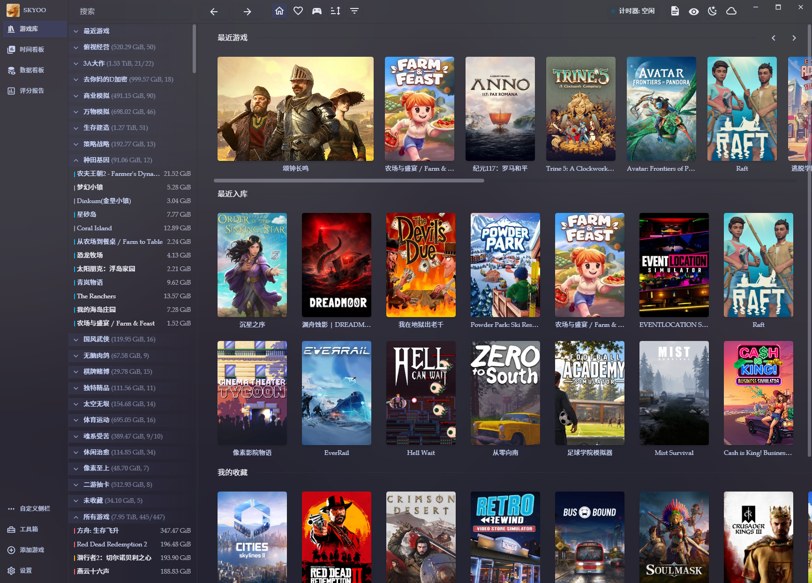
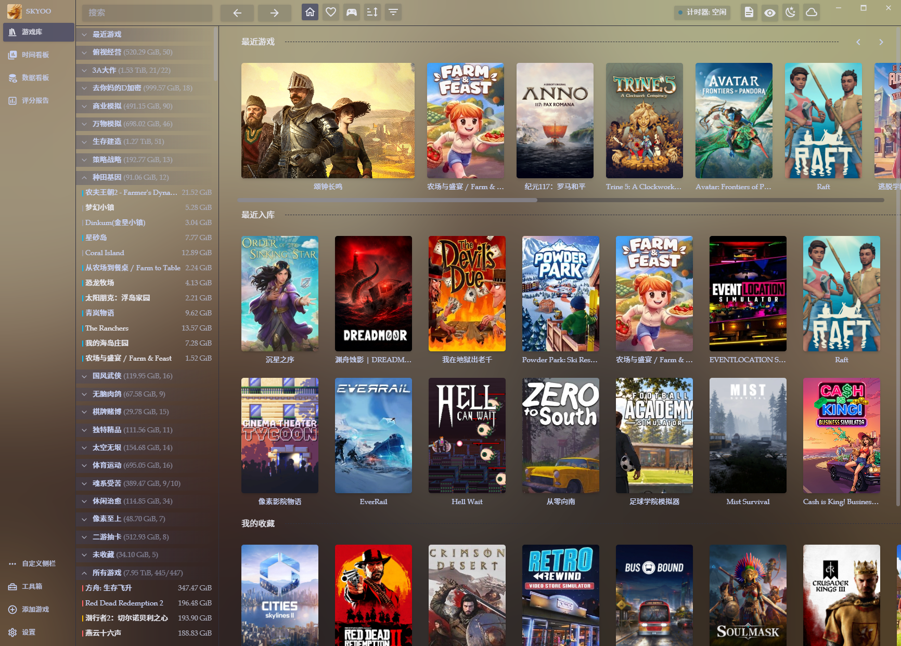

<div align="center">
  

  <h1 align="center">
    Skyoo
  </h1>

  <p align="center">
    <a href="https://www.electronjs.org/" target="_blank"></a>
    <a href="https://reactjs.org/" target="_blank"></a>
    <a href="https://www.gnu.org/licenses/gpl-3.0.en.html" target="_blank"></a>
    </br>
    <a href="https://github.com/Saigic-Yang/vnite-Skyoo/stargazers"></a>
    <a href="https://github.com/Saigic-Yang/vnite-Skyoo/graphs/contributors"></a>
    <a href="https://github.com/Saigic-Yang/vnite-Skyoo/releases"></a>
  </p>
</div>

> **本项目基于 [Vnite](https://github.com/ximu3/vnite)（GPL-3.0）修改而来，当前为 Skyoo 定制版。**
>
> - 修改日期：2026-11-14
> - 原项目版权归其作者与贡献者所有；本项目同样以 **GPL-3.0** 协议发布，完整源码见本仓库
> - 上游仓库：https://github.com/ximu3/vnite
> - 本定制版分支：https://github.com/Saigic-Yang/vnite-Skyoo/tree/skyoo
>
> This is a modified version of [Vnite](https://github.com/ximu3/vnite) (GPL-3.0), modified on 2026-11-14.
> Original copyright belongs to its authors and contributors. Released under GPL-3.0 as well.

Skyoo 是一个面向本地游戏库的管理工具。它在 Vnite 的基础上做了界面与交互的重构，主打「沉浸式游戏墙 + 完整的游玩记录」，可以统一管理游戏、记录游玩时长与评分，并生成多维度的统计报告。

## ✨ 相较上游的主要改动

- **界面重构**：侧栏可拖动调宽 / 文字随宽度渐显，图标可拖动排序并记忆位置
- **顶栏自定义**：搜索框、前进后退、主页、收藏、所有游戏、筛选、排序，按钮可拖动排序
- **沉浸式卡片墙**：卡片 3D 悬停动效（跟随鼠标、带纵深），最近游戏 / 最近入库 / 我的收藏分区展示
- **评分体系重做**：Steam / Metacritic / OpenCritic 多源评分，1~10 整数打分，Steam 官方评价配色
- **评分报告**：按 1 / 2~3 / 4~5 / 6~7 / 8~9 / 10 六档分组，标题与说明文案可编辑，并保留最近 4 条历史
- **详情页动效**：大背景 3D 跟随、徽标（logo）独立 3D 悬停，并与背景动效互斥
- **游戏状态**：未开始 / 游玩中 / 部分完成 / 已完成 / 多周目 / 已删除 / 搁置中，配色区分
- **相关网站**：Steam、SteamDB、Metacritic、OpenCritic、HowLongToBeat、小黑盒一键直达

## 🧩 继承自上游的能力

- 插件系统与插件市场
- 多设备云同步（游戏记录、存档、设置）
- 多数据源刮削（Steam、IGDB、Bangumi 等）
- 扫描器：自定义目录结构与数据源，自动入库
- 元数据转换器：正则改写、替换、合并、排除
- 年报 / 月报 / 周报与导出报告
- 与其他程序集成（LE 转区、Magpie 缩放、模拟器启动等）
- 一键导入 Steam 库（保留游戏时长）
- 多种启动方式（文件 / 链接 / 脚本）、自定义元数据筛选、会话计时器等

## Development

需要 Node.js 20.19+（20.x）或 22.12+，以及 `package.json` 中锁定的 pnpm 版本。

构建 Windows 原生模块还需要 Rust MSVC 工具链和装有 Windows SDK 的 Visual Studio C++ 生成工具。

```sh
pnpm install --frozen-lockfile
pnpm build:native
pnpm dev
```

`pnpm typecheck` 检查类型，`pnpm build` 编译，`pnpm build:win` 生成 Windows 安装包。

## 📸 Screenshots

<details open>
<summary>Dark</summary>



</details>

<details>
<summary>Light</summary>



</details>

## 📦 Download

安装包发布在 [Releases](https://github.com/Saigic-Yang/vnite-Skyoo/releases) 页面，下载 `skyoo-*-setup.exe` 安装即可。

## ⭐ Acknowledgements

- [Vnite](https://github.com/ximu3/vnite) — 本项目的基础
- [VNDB API](https://api.vndb.org/kana)
- [Steam API](https://partner.steamgames.com/doc/api)
- [SteamGridDB](https://www.steamgriddb.com/)
- [IGDB API](https://api-docs.igdb.com/)
- [Metacritic](https://www.metacritic.com/)
- [OpenCritic](https://opencritic.com/)
- ...
